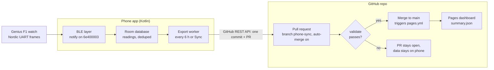

# Genius F1 Android App: Implementation Plan

Oct 14, 2026 · @Liam

## Summary

Yes, an Android app can connect to the Genius F1. Everything it needs to say to the watch is already worked out and tested from the laptop. The Wearfit Pro app does the same job on Android every day, which also shows Android's Bluetooth stack copes with this watch.

The plan has three parts:

1. **Watch to phone.** A Kotlin app connects over Bluetooth Low Energy and speaks the WearFit protocol from `genius_f1.py`. It stores readings (heart rate, steps, SpO2, battery) in a local database.
2. **Phone to GitHub.** On a schedule, or when you tap Sync, the app writes new readings as JSON files to a new branch of your repo and opens a pull request.
3. **GitHub to a web page.** A check validates the files on the pull request. When it is merged into `main`, a GitHub Actions workflow rebuilds a dashboard and publishes it to GitHub Pages.



Nothing reaches `main` or the public page until the `validate` check passes. A failed check leaves the pull request open, and the readings stay unexported on the phone.

**Decisions (14 Oct 2026)**

- **Public showcase.** The repo and the dashboard are public. The page tells the story of bringing an old watch back to life with reverse engineering, alongside the live readings it logs.
- **No location, ever.** The watch has no GPS, and the app never asks for location: scanning uses `neverForLocation` and the pairing dialog. Nothing in the data or the repo identifies the device, the phone or where you are.
- **Every reading, even the flaky ones.** Heart rate, steps and battery are confirmed. SpO2, blood pressure and history sync ship as *experimental*. Every attempt is logged, and the dashboard shows how often each one works.
- **Sync every 6 hours.**
- **The laptop tools live in the repo** under `tools/`, once device identifiers are removed (see the GitHub section).

Estimated effort for one developer new to Android BLE: about 4 to 6 weekends across the six phases in the build plan.

## What the laptop work already proved

The Python tools in `SmartwatchDetection` are the reference implementation: port their logic, and use their captured frames as test data. Full byte layouts are in `PROTOCOL.md`.

**Connection facts**

- Watch name `F1`, a static random Bluetooth address (kept out of the repo), firmware 3.24, model code 162.
- Commands go over the Nordic UART service `6e400001-…`: write to `6e400002-…`, notifications come back on `6e400003-…`.
- Frames are `AB LEN_HI LEN_LO FF CMD KIND ARGS…`. They are split into 20-byte writes, with a sequence byte on each continuation chunk.
- No pairing or bonding is needed.

**Confirmed working**

| Feature | Send | Reply |
| --- | --- | --- |
| Battery | `AB 00 03 FF 91 80` | `91 80 <charging> <percent>` |
| Firmware / model | `AB 00 04 FF 92 80 01` | `92 C0 <major> <minor> <model> …` |
| Set clock | `93 80 00 YY YY MM DD hh mm ss` | none (confirmed on screen) |
| Vibrate | `AB 00 03 FF 71 80` | none (confirmed) |
| Live heart rate | `AB 00 04 FF 31 0A 01` (on) / `…00` (off) | `31 0A 00 <bpm>`, about every 5 s |
| Today's steps | read characteristic `FEA1` | flag + steps (3 bytes, little-endian) |

**Quirks the app must respect**

- **One connection at a time.** If the Wearfit app or the laptop holds the watch, your app can't see it. Uninstall or disable Wearfit on the phone you build for.
- **Don't subscribe to anything except `6e400003`.** Subscribing to every channel during the first laptop report left the watch remembering an `FEA1` subscription, and connections stalled after that. Read `FEA1`; never enable its indications. Unsubscribe before disconnecting.
- **The watch ignores the MTU exchange request.** BlueZ on Linux always sends it first and hangs. Android only sends it when the app calls `requestMtu()`, so don't call it. 20-byte chunks fit the default MTU of 23.
- **Setting the clock can reset today's step count.** It happened once (460 steps before, 0 after). Set the clock once per day, not on every connect.

**Not yet confirmed** (test with the laptop tools before relying on them)

- SpO2 (`31 11`): the only reading so far was an implausible 37%, probably cut short.
- Blood pressure (`31 21`): untested; systolic/diastolic order unknown.
- History sync (`51`): only the all-zero "today" frame has come back, so the history record formats (`51 11`, `51 12`, `51 20`) are unverified.
- Notifications to the watch (`72`): untested.

## App architecture and tech stack

Build a single-module Kotlin app with four layers: a **protocol** library with no Android code, a **BLE** layer that owns the connection, a **Room** database, and a **sync** layer that talks to GitHub. The screens only read from the database, so the watch connection and GitHub uploads keep working when the app is closed.

| Part | Choice | Why |
| --- | --- | --- |
| Language / UI | Kotlin, Jetpack Compose, Material 3 | Current Android default; Android Studio templates start here |
| Min / target SDK | minSdk 26 (Android 8), targetSdk = latest stable | Covers almost all phones in use; you'll install the app yourself, so the Play Store's target rules only matter if you publish |
| BLE | Nordic [Android-BLE-Library](https://github.com/NordicSemiconductor/Android-BLE-Library) | Queues GATT operations and handles Android's retry quirks; the Wearfit app itself uses Nordic's stack |
| Pairing screen | `CompanionDeviceManager` | System dialog to pick the watch once; no location permission; lets the app reconnect from the background |
| Background work | Foreground service (type `connectedDevice`) for live heart rate; `WorkManager` for periodic sync | Android stops plain background services; these two are the supported routes |
| Storage | Room (SQLite) | Typed queries, migrations, Flow updates for Compose |
| Secrets | Android Keystore via `EncryptedSharedPreferences` (or the newer DataStore + Tink) | Keeps the GitHub token encrypted on the phone |
| HTTP / JSON | OkHttp + kotlinx.serialization | Small, well-known; enough for GitHub's REST API |
| Tests | JUnit for the protocol module; Robolectric or an emulator for Room | The protocol tests run without a phone |

**Permissions** (Android 12 and later)

- `BLUETOOTH_SCAN` with `android:usesPermissionFlags="neverForLocation"`, and `BLUETOOTH_CONNECT`.
- `FOREGROUND_SERVICE` and `FOREGROUND_SERVICE_CONNECTED_DEVICE` (required from Android 14).
- `POST_NOTIFICATIONS`, for the foreground-service notification on Android 13+.
- `INTERNET`, for GitHub.
- On Android 11 and lower: `BLUETOOTH`, `BLUETOOTH_ADMIN` and `ACCESS_FINE_LOCATION` instead of the first two.

**Project layout**

```
app/src/main/java/.../f1/
  protocol/   Frame.kt, Splitter.kt, Reassembler.kt, Commands.kt, Decoder.kt   (pure Kotlin)
  ble/        F1BleManager.kt, WatchService.kt (foreground), Pairing.kt
  data/       AppDatabase.kt, Reading.kt, ReadingDao.kt, SyncState.kt
  sync/       GitHubClient.kt, ExportWorker.kt, JsonExporter.kt
  ui/         Dashboard, LiveHeartRate, Settings (token, repo, sync schedule)
```

## Bluetooth implementation, step by step

Port the protocol first, test it against frames captured on the laptop, and only then touch Bluetooth. Most BLE bugs turn out to be framing bugs.

**1. Protocol module (pure Kotlin, a direct port of `genius_f1.py`)**

```kotlin
fun frame(cmd: Int, args: ByteArray = byteArrayOf(), kind: Int = 0x80): ByteArray {
    val n = args.size + 3
    return byteArrayOf(0xAB.toByte(), (n shr 8).toByte(), n.toByte(), 0xFF.toByte(),
                       cmd.toByte(), kind.toByte()) + args
}

// First 20 bytes as-is; each continuation = [seq] + next 19 bytes
fun split(data: ByteArray, size: Int = 20): List<ByteArray> { /* see genius_f1.split */ }

class Reassembler {           // total = bytes 1-2 + 3; drop the seq byte of continuations
    fun feed(packet: ByteArray): ByteArray? { /* see genius_f1.Reassembler */ }
}

sealed interface WatchEvent {
    data class Battery(val percent: Int, val charging: Boolean) : WatchEvent
    data class DeviceInfo(val firmware: String, val model: Int) : WatchEvent
    data class HeartRate(val bpm: Int) : WatchEvent
    data class Steps(val steps: Int) : WatchEvent
    data class Unknown(val raw: ByteArray) : WatchEvent   // always log these
}
fun decode(frame: ByteArray): WatchEvent
```

Golden tests: feed the exact hex from your reports through `decode` and assert the result. For example, `ab0005ff91800050` gives 80% battery, `ab0005ff310a0056` gives 86 bpm, and `ab000dff92c00318a200000000000022` gives firmware 3.24, model 162. Add a split/reassemble round-trip test for lengths 0 to 100, as done for the Python version.

**2. Pair once with `CompanionDeviceManager`**

- Build an `AssociationRequest` with a `BluetoothLeDeviceFilter` that matches name `F1` (and optionally the service UUID `0000fee7-…`, which the watch advertises; the UART service isn't in its advert).
- Save the chosen MAC address. Later connects go straight to that address, with no scanning.

**3. Connect and set up (`F1BleManager`)**

1. `connect(device).useAutoConnect(false).retry(3, 200)` with LE transport.
2. Discover services. Fail clearly if `6e400001-…` is missing.
3. Don't call `requestMtu()`: the watch never answers it (see the quirks above).
4. Enable notifications on `6e400003-…` only. Route every packet through the `Reassembler`.
5. Send the clock (`93`) once per day, then device info (`92`) and battery (`91`).
6. Read `FEA1` for today's steps. Never enable notifications on it.
7. Write with *write without response* (`WRITE_TYPE_NO_RESPONSE`), one 20-byte chunk at a time; the Nordic library queues them.
8. If a frame starts `EA` with command `0B`, reply `EA 00 03 00 0B 02` (the newer-firmware heartbeat).
9. On disconnect, disable notifications on `6e400003` first, then close the connection.

**4. Features on top**

- **Live heart rate**: a foreground service sends `31 0A 01` and stores each reply. It sends `31 0A 00` when you stop it, or after a time limit (for example 10 minutes) to protect the watch battery.
- **Spot checks** (SpO2, blood pressure): send the start command, wait up to 60 s for a non-zero value, then send the stop command. Ship them as experimental: record every attempt and its outcome (got a value, timed out, or out of range) so they can be improved from real data.
- **Periodic snapshot**: a `WorkManager` job every 1 to 3 hours connects, reads battery and steps, takes one short heart-rate sample, tries one SpO2 reading and a history sync (both experimental), and disconnects.
- **Errors**: if a connect times out, back off (1, 5, 15 minutes) instead of retrying in a tight loop. Show "Watch busy: is Wearfit or the laptop connected?" after repeated failures.

**5. Prove it before writing UI**

Build a debug screen with Connect, Battery, Vibrate and Live HR buttons and a scrolling log of raw hex in and out, like the laptop's `listen` command. Use [nRF Connect](https://play.google.com/store/apps/details?id=no.nordicsemi.android.mcp) on the phone to inspect the watch's channels if anything disagrees with `PROTOCOL.md`.

## Storing data on the phone

Store every reading as one row in a single Room table, keyed so the same reading can never be saved twice. Track which rows have reached GitHub with an `exported` flag. The phone is the source of truth until data is merged; GitHub is the long-term archive.

**`readings` table**

| Column | Type | Example | Notes |
| --- | --- | --- | --- |
| `id` | Long, auto | 1532 | Primary key |
| `type` | String | `hr`, `steps`, `spo2`, `bp`, `battery` | One table for all kinds keeps export simple |
| `takenAt` | Long (epoch ms, UTC) | 1791986400000 | When the watch measured it; for live values, when the phone received it |
| `value1` | Int | 86 | bpm, steps, %, systolic |
| `value2` | Int? | 79 | Only for blood pressure (diastolic) |
| `source` | String | `live`, `spot`, `history`, `snapshot` | How it was obtained |
| `exported` | Boolean | false | Set true only after the pull request is created |

Add a unique index on (`type`, `takenAt`, `source`) and insert with `OnConflictStrategy.IGNORE`. A history sync that returns the same records again then adds nothing.

**What gets recorded, and how often**

- **Live heart rate**: the watch sends a value about every 5 s. Store at most one row per 30 s (keep the latest), or a 10-minute session fills the table with near-duplicates.
- **Steps**: one row per snapshot, holding the running daily total from `FEA1`. The dashboard uses the day's last value.
- **Battery**: one row per connection. That's useful for spotting battery drain.
- **History** (once confirmed): every record the `51` sync returns, with `source = history` and the watch's timestamp.

**`sync_state` table**: a single row with `lastHistorySync` (sent as the "since" date in the next `51` request), `lastClockSet`, `lastExport` and `lastPullRequestUrl`.

**`attempts` table**: one row per measurement or sync the app tries, successful or not. This is what powers the "how well does it work" part of the dashboard.

| Column | Type | Example |
| --- | --- | --- |
| `startedAt` | Long (epoch ms, UTC) | 1791986400000 |
| `kind` | String | `connect`, `hr`, `spo2`, `bp`, `history`, `notify` |
| `outcome` | String | `ok`, `timeout`, `out_of_range`, `no_reply`, `error` |
| `durationMs` | Int | 41250 |
| `detail` | String? | the raw reply hex for anything unexpected, so new frames can be decoded later |

Out-of-range values (SpO2 below 70%, heart rate outside 30–220 bpm) are recorded here as `out_of_range` and kept out of `readings`.

**Retention**: keep everything locally for 90 days, then delete rows that are both exported and older than that. One row is about 40 bytes, so a year of 30-second heart-rate samples during 1 hour a day (about 44,000 rows) is under 2 MB before indexes.

## Sending data to GitHub

The app keeps one rolling branch, `phone-sync`, with at most one open pull request into `main`. Each sync adds a single commit holding that day's JSON files, then makes sure the pull request exists with auto-merge on. Only the app writes under `data/`, and it rewrites a whole day's file from its database each time, so merge conflicts can't happen.

**Repo layout**

```
android/                                the Kotlin app (Android Studio project)
tools/                                  laptop tools: genius_f1.py, raw_att.py, f1_report.py, run.sh, PROTOCOL.md
data/readings/2026/10/2026-10-14.json   one file per day, written only by the phone
data/attempts/2026/10/2026-10-14.json   that day's attempts and outcomes
schema/                                 JSON Schemas the CI check validates against
site/                                   dashboard source (HTML/JS)
scripts/build_summary.py                turns data/ into site/summary.json at build time
.github/workflows/validate.yml          runs on pull requests
.github/workflows/pages.yml             runs on push to main, deploys Pages
.gitignore                              tools/reports/, tools/.venv*, local.properties, *.keystore
```

**Before the laptop tools go in the repo**, remove what identifies your hardware. A check of the current files found only two places in the code; the saved reports hold the rest.

- [ ] `PROTOCOL.md` section 7: replace the watch's Bluetooth address with `XX:XX:XX:XX:XX:XX`. Firmware 3.24 and model code 162 are fine to keep: they describe the model, not your unit.
- [ ] `run.sh` `debug`: remove the default address so it must be passed in (or read from a git-ignored `tools/.env`).
- [ ] Never commit `tools/reports/`. Those files contain the watch's and laptop's Bluetooth addresses, the laptop's name, your username and nearby devices. If you want an example in the repo, add one hand-cleaned report.
- [ ] Day files carry no address or serial. `device` holds only the model name and firmware.
- [ ] Before the first push, run `git grep -i -E "[0-9a-f]{2}(:[0-9a-f]{2}){5}"` to catch any Bluetooth address that slipped through.

A day file, with keys and readings sorted so a re-export of unchanged data produces no diff:

```json
{
  "date": "2026-10-14",
  "device": { "name": "F1", "firmware": "3.24" },
  "readings": [
    { "t": "2026-10-14T11:05:30Z", "type": "hr", "v": 86, "src": "live" },
    { "t": "2026-10-14T12:00:00Z", "type": "steps", "v": 249, "src": "snapshot" },
    { "t": "2026-10-14T12:00:00Z", "type": "battery", "v": 80, "src": "snapshot" }
  ]
}
```

**Authentication**

- Create a [fine-grained personal access token](https://github.com/settings/personal-access-tokens) limited to **this one repo**, with **Contents: read and write** and **Pull requests: read and write**.
- Give it an expiry (for example 1 year) and set a reminder to renew it.
- Paste it into the app's Settings screen once. Store it encrypted with the Android Keystore, and never put it in source code or logs.
- For a personal app this is enough. A GitHub App with the device login flow is the upgrade path if other people will ever use it.

**One sync, step by step** (`ExportWorker`, run by `WorkManager` every 6 hours on Wi-Fi, or from a Sync button)

1. Query unexported readings and attempts, group them by day, and rebuild each affected day file from **all** rows for that day.
2. `GET /repos/{owner}/{repo}/git/ref/heads/phone-sync`. If you get 404, read `main`'s SHA and `POST /git/refs` to create the branch from it.
3. `POST /git/trees` with `base_tree` set to the branch head's tree and one entry per day file (`mode 100644`, inline `content`). Then `POST /git/commits` with that tree and the head as parent, and `PATCH /git/refs/heads/phone-sync`. That's one commit, however many files.
4. `GET /pulls?head={owner}:phone-sync&state=open`. If there's none, `POST /pulls` (title like "Watch data 2026-10-14", base `main`).
5. Turn on auto-merge with the GraphQL mutation `enablePullRequestAutoMerge` (merge method `SQUASH`). REST has no endpoint for this.
6. Only now, mark those rows `exported = true` in one transaction. If any step fails, nothing is marked, and the next run retries the same data.

**Repo settings, once**

- Turn on **Allow auto-merge** and **Automatically delete head branches**. After each merge the branch is deleted, and the next sync recreates it from the new `main`.
- Add a branch rule on `main` that requires the `validate` check to pass. Auto-merge is only offered on pull requests that can't merge yet, so without a required check it has nothing to wait for. On a private repo, branch rules need GitHub Pro or above.
- Keep the merge in your name (through your token and auto-merge), not through a workflow's built-in `GITHUB_TOKEN`. GitHub doesn't start new workflow runs from events that `GITHUB_TOKEN` causes, so a merge done that way would never trigger the Pages deploy.

## GitHub side: checks, Pages and privacy

Two workflows do all the work. `validate.yml` blocks bad data from reaching `main`. `pages.yml` rebuilds and publishes the dashboard on every merge. The repo and the page are public by choice, so the data must never contain location or device identifiers.

**`validate.yml`** (the required check)

```yaml
name: validate
on: pull_request
jobs:
  validate:
    runs-on: ubuntu-latest
    steps:
      - uses: actions/checkout@v4
      - run: pip install check-jsonschema
      - run: find data/readings -name '*.json' -print0 | xargs -0 -r check-jsonschema --schemafile schema/readings.schema.json
      - name: no device identifiers in data
        run: |
          ! grep -rniE '([0-9a-f]{2}:){5}[0-9a-f]{2}|"(lat|lon|latitude|longitude|location)"' data/
      - run: python scripts/build_summary.py --check   # sanity rules: bpm 30-220, SpO2 70-100, steps >= 0
```

**`pages.yml`** (runs after the merge)

```yaml
name: pages
on:
  push:
    branches: [main]
  workflow_dispatch:
permissions:
  contents: read
  pages: write
  id-token: write
concurrency: { group: pages, cancel-in-progress: true }
jobs:
  build:
    runs-on: ubuntu-latest
    steps:
      - uses: actions/checkout@v4
      - run: python scripts/build_summary.py --out site/summary.json
      - uses: actions/upload-pages-artifact@v3
        with: { path: site }
  deploy:
    needs: build
    runs-on: ubuntu-latest
    environment: { name: github-pages, url: "${{ steps.d.outputs.page_url }}" }
    steps:
      - id: d
        uses: actions/deploy-pages@v4
```

In the repo's **Settings → Pages**, set the source to **GitHub Actions**. Check the actions' latest major versions when you create the files.

**The dashboard (`site/`)**

The page has two jobs: show off the reverse-engineering work, and show the watch working today. Build it as plain `index.html` + one JS file + [Chart.js](https://www.chartjs.org/) from a CDN, with no build tool. `build_summary.py` reads every day file and writes one `summary.json` the page loads.

1. **Hero strip**: "A 2020s budget smartwatch, brought back with reverse-engineered Bluetooth." Underneath, live tiles: last sync time (green under 7 hours, amber after), days logged, readings logged, and current battery.
2. **How it was done**: a short timeline of the journey. It worked on the laptop, then stalled on the MTU request, was diagnosed with btmon, and was fixed by writing raw ATT on CID 4. Include the end-to-end diagram from this plan and a link to `tools/PROTOCOL.md`.
3. **Protocol status**: one row per feature (battery, firmware, clock, vibrate, heart rate, steps, SpO2, blood pressure, history, notifications), with a status chip (confirmed / experimental / not working) and its 30-day success rate from the `attempts` files.
4. **Readings**: steps per day (bars); daily heart-rate range (low to high, average marked); SpO2 and blood-pressure readings as points, labelled experimental; battery over time (line).
5. **Reliability**: attempts per day, stacked by outcome (`ok`, `timeout`, `out_of_range`). Flaky features look honest rather than broken, and the chart shows improvement as the decoders get better.
6. **Footer**: links to the repo, the Android app source and the laptop tools.

**Privacy: what is public, and what is never collected**

On GitHub's free plan the repo and the Pages site are both public. That's the point here, so keep these rules in the code, not just in your head:

- **Never collected**: location (no location permission; the watch has no GPS), contacts, notification contents from the phone.
- **Never written to the repo**: the watch's or phone's Bluetooth address, serial numbers, the GitHub token, the laptop's `reports/`.
- **Public by design**: timestamps (in UTC) and values of heart rate, steps, SpO2, blood pressure and battery, plus attempt outcomes.
- **Enforced by CI**: `validate.yml` fails a pull request if any data file contains a key outside the schema, or anything shaped like a Bluetooth address. A slip can't reach `main`.
- **Changing your mind later**: making the repo private stops new visitors, but anything already public may have been copied. Decide what goes public before the first sync.

## Build plan

Build in six phases, each ending in something you can test on the real watch. Don't start a phase until the previous one's "done when" holds. Phase 0 uses the laptop tools you already have.

1. **Phase 0: finish the protocol on the laptop** (about 1 evening)
   - Switch the laptop's report to the direct (`raw-`) connection; today only `raw-info`, `raw-hr` and `raw-find` use it. Then run it to capture SpO2 for a full 60 s, blood pressure, history sync since 2000, and a test notification.
   - This phase runs alongside the others, not before them: features without a captured reply still ship, marked experimental. Done when every feature has at least one capture attempt recorded in `PROTOCOL.md`.
2. **Phase 1: protocol module + tests** (1 weekend)
   - New Android Studio project (Empty Compose Activity). Port frame, split, reassembler and decode into `protocol/`.
   - Done when the golden tests pass for every frame in your saved reports.
3. **Phase 2: connect and talk** (1 weekend)
   - Permissions, `CompanionDeviceManager` pairing, `F1BleManager`, and the debug screen with the raw hex log.
   - Done when, with Wearfit removed, the app shows battery 80% and firmware 3.24, the Vibrate button works, and Live HR shows bpm. Then disconnect and reconnect 10 times in a row without a failure.
4. **Phase 3: store it** (1 weekend)
   - Room tables, foreground service for live heart rate, `WorkManager` snapshot job, simple dashboard screen.
   - Done when the app left alone for 24 hours has snapshots every 1 to 3 hours with no duplicate rows, and the watch battery drop is acceptable to you (compare with Wearfit's).
5. **Phase 4: GitHub pipeline, without the phone** (1 evening)
   - Create the public repo, move the laptop tools into tools/ after the identifier checklist, add the schema, both workflows, `build_summary.py` and a first dashboard. Hand-write two day files, open a pull request from the GitHub website and merge it.
   - Done when the check runs on the pull request and the Pages site updates after the merge.
6. **Phase 5: phone to GitHub** (1 weekend)
   - Settings screen (token, owner/repo), `GitHubClient`, `ExportWorker`.
   - Done when a Sync tap opens or updates the `phone-sync` pull request, it auto-merges after the check passes, and the page shows today's data. Then turn on airplane mode mid-sync: nothing is marked exported, and the next sync recovers.

**How to install it on your phone without the Play Store**: turn on Developer options and USB debugging, plug the phone into the laptop, and press Run in Android Studio. Or build an APK (**Build → Build APK**) and copy it across.

## Risks and decisions

The biggest risk is the unconfirmed parts of the protocol, not Android or GitHub. Close them in Phase 0, before writing Kotlin for them.

| Risk | Likelihood | What happens | Fallback |
| --- | --- | --- | --- |
| SpO2, blood pressure or history formats differ from Wearfit Pro's | Medium | Those screens show nothing or wrong values | Capture real frames on the laptop first; ship heart rate, steps and battery without them |
| The watch stalls again on the phone (remembered subscriptions) | Low | Android can't finish connecting | Unsubscribe before every disconnect; worst case, factory reset with `raw-reset` from the laptop |
| Wearfit or the laptop grabs the watch | High at first | "Watch not found" | Uninstall Wearfit on that phone; close laptop tools before syncing |
| Android stops background work (phone makers' battery savers) | Medium | Gaps in snapshots | Ask for the battery-optimisation exemption; the Sync button always works |
| Clock set resets today's steps | Medium | A step count drops to 0 mid-day | Set the clock once a day, early; the dashboard uses each day's maximum |
| Token leaks or expires | Low | Sync stops, or someone writes to your repo | Single-repo fine-grained token, encrypted on the phone; the app shows a clear "token expired" message |
| An identifier or location slips into public data | Low | Your device or whereabouts become public | Schema with no location fields, plus the CI check that rejects Bluetooth addresses; the identifier checklist before the tools go in |

**Decided on 14 Oct 2026**

- [x] Privacy: public repo and public dashboard as a showcase; no location and no device identifiers, ever.
- [x] Readings: attempt all of them; heart rate, steps and battery are confirmed, the rest ship as experimental with their success rate shown.
- [x] Sync: every 6 hours, plus the Sync button.
- [x] Laptop tools: in the same repo under `tools/`, after the identifier checklist.
